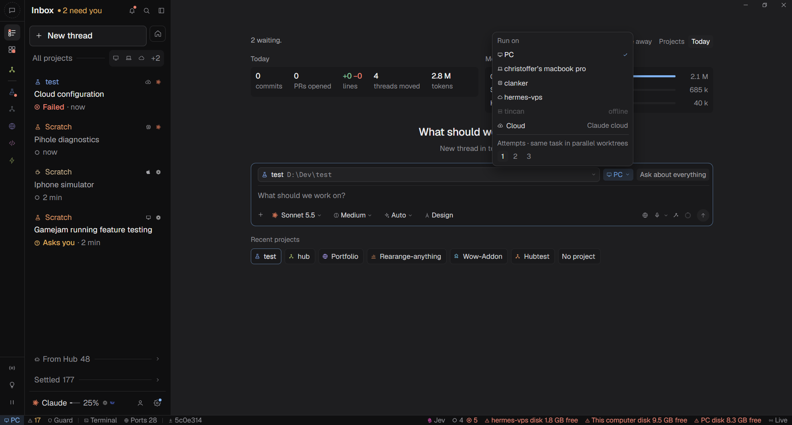
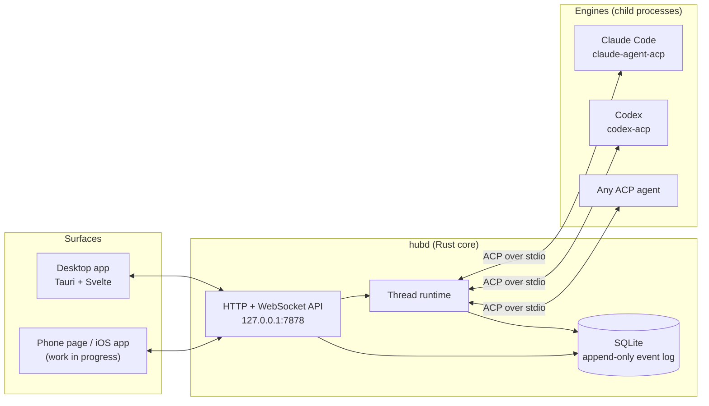
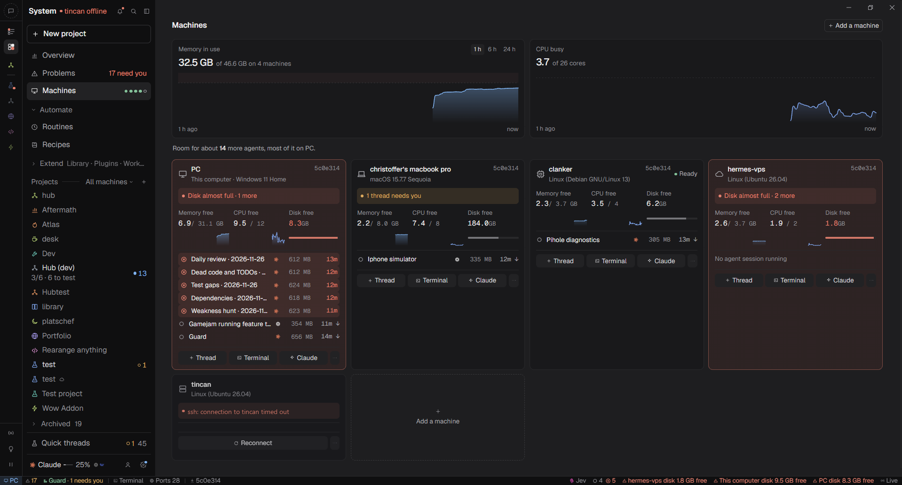
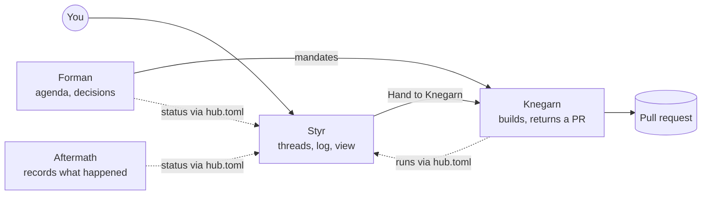

# Styr
An agentic development environment for keeping track of everything your AI coding agents are doing.

Working with AI agents gets messy fast. Threads multiply, agents drift off task, and work gets
left half done and forgotten in some terminal. I built this to have one place where I can see
all of it and steer it. It runs Claude Code (and Codex, or any agent that speaks the Agent Client
Protocol) in the background, writes everything that happens to a local log, and shows what is
running, what is waiting on me and what got finished. It is a personal project that I use every
day, built largely with AI agents working under the rules in [CLAUDE.md](CLAUDE.md).

The project is nowhere close to done and has a lot of work left. Feel free to fork it and try
it out, or build a new feature or fix a bug using Claude and open a PR! See
[Status](#status) and [Contributing](#contributing).



The app itself is called Hub. That is the name used in the code, the docs and the Start menu
(`hubd`, `hub.toml`); Styr is the name of the repository.

## What it does

- **Threads in any folder.** Each thread is a Claude Code or Codex session driven over ACP.
  Replies stream live. Tool calls and plans are shown. Permission questions wait for you with
  Allow and Reject.
- **Stop, queue, resume.** Stop a running turn or queue follow-ups while it works. The engine
  session is resumed after a crash, after closing the window and after restarting the core.
- **One event log.** Everything is appended to a SQLite log. Every view reads from it.
- **This computer.** CPU, memory and every listening port with its process, grouped by the
  thread whose folder it runs in. A Stop button for stray dev servers.
- **Projects.** Create a project from a name (folder, git, a plan in `docs/plan.md`, a GitHub
  repo if `gh` is logged in). The project page shows branch, PRs, CI, plan and threads.
- **Every machine.** The same server (`hubd`) runs on each of your machines: Windows, Linux,
  a Mac, a VPS. Pick where a thread runs from the composer, and every thread lands in one list.
  See [One server on every machine](#one-server-on-every-machine).
- **Attempts.** Run the same task up to three times at once, each in its own worktree.
- **Take over.** Open a thread's session in the engine's own CLI, in a terminal inside the app.
- **Workers.** Your own tools (see [the stack](#how-it-fits-with-the-rest-of-the-stack)) show
  their status, queues and buttons in the app.
- **Self-update.** The installed app builds new commits on `main` in the background and switches
  once no thread is working. This is experimental and built for developing the app itself.

Many of these are unfinished. See [Status](#status).

## Architecture



- The core is its own process (`hubd`), so threads keep running when the window closes.
- Engines are ACP agents started by command, one child process per active thread.
- The event log is append-only. New behaviour adds new event kinds instead of changing old ones.
- The Rust model is the source of truth for API types. TypeScript bindings are generated from it
  (`ts-rs`), so the app and core cannot drift apart.

| Path | What it is |
|---|---|
| `crates/hub-core` | The core library: model, store, thread runtime, ACP engine, API. |
| `crates/hubd` | The daemon binary and its subcommands (`pair`, `attach`, ...). |
| `crates/hub-install` | Where an installed version lives on disk. |
| `crates/hub-launcher` | Starts the current installed version. The Start menu points here. |
| `crates/mock-agent` | A scripted ACP agent for tests and for trying the UI without tokens. |
| `app/` | The Svelte UI. `app/src-tauri` is the desktop shell. |
| `ios/` | A SwiftUI client. |

More in [docs/ARCHITECTURE.md](docs/ARCHITECTURE.md), and [docs/MAP.md](docs/MAP.md) says where
each thing lives.

## One server on every machine

The app is only a window. The work happens in `hubd`, a small Rust server, and the same `hubd`
runs on every machine you own. Each one runs its own threads with its own engines and log, so
a thread on the Linux box keeps going while the PC sleeps. The PC keeps a connection to each
and shows them as one system.



- To add a machine your SSH config reaches, use Settings > Machines > Install. It sends the
  code over and installs it, with no terminal. Or run `bash scripts/install-host.sh` on the
  machine itself (Linux or macOS). Either way `hubd` is installed as a user service (systemd,
  or launchd on a Mac) and prints a pairing code.
- `hubd` only listens on `127.0.0.1`, so nothing is opened to the internet. Other machines
  reach it through Tailscale (`tailscale serve`, HTTPS inside your tailnet) or an SSH tunnel
  with your own keys. The tunnel is the fallback when Tailscale does not answer.
- Machines are paired with a code, not a password. Make one with `hubd pair` (or in Settings)
  and give it to the other machine, which gets a token of its own.
- Engines and sign-ins are set up once, on the PC, and handed to each machine. A machine that
  lacks Claude Code or Codex installs it itself. New versions are sent out from the PC, so
  every machine stays on the same build.
- A second Windows PC does not compile anything. It copies the installed build from a paired
  PC (`install.ps1 -From http://<pc>:7878 -Code ABCD-EFGH`).

Every `hubd` also serves a phone page to your tailnet (pair it from a QR code in Settings >
Access), and there is a SwiftUI client in `ios/`. Both follow and answer threads on all
machines. They are a work in progress and do not work on iPhone right now.

## Install and build

The desktop app runs on Windows. It needs Git, Rust (stable), Node 22+, and Claude Code
installed and logged in.

```powershell
git clone https://github.com/KarlssonChristoffer/styr.git
cd styr
powershell -ExecutionPolicy Bypass -File scripts\install.ps1
```

Development build:

```powershell
cd app; npm install; cd ..
cargo build -p hubd
cd app; npm run tauri dev
```

Tests:

```sh
cargo test --workspace                 # includes end-to-end thread tests against mock-agent
cd app && npm run check && npm test    # svelte-check and vitest
```

Updates, a second PC, config and the mock agent are covered in
[docs/INSTALL.md](docs/INSTALL.md). The rest of the documentation is indexed in
[docs/](docs/README.md).

## How it fits with the rest of the stack

This is the control surface. The other parts are separate repositories, which are not public
yet:

- Knegarn takes an approved task, builds it unattended and hands back a pull request.
- Forman is the foreman over Knegarn: agenda, questions and decisions.
- Aftermath records what actually happened and compares how the work was done.



Each tool puts a `hub.toml` in its own folder. The app reads it and shows that tool's status,
lists and actions, running the tool's own CLI. Examples: [docs/examples/](docs/examples/).

## Status

Unfinished and experimental. I use it every day, but it is not a product and a lot is left to
do.

- Many features are half built or rough, and things change without notice.
- Some parts exist for developing the app itself and are experimental: the self-update that
  builds from `main`, and the merge, review and build rules for agents in `CLAUDE.md`.
- Windows first. The server also runs on Linux and macOS. The phone page and the iOS client
  are a work in progress.
- A few names are Swedish (Knegarn, Forman, some scripts and doc headers).

## Contributing

Forks and pull requests are welcome, including ones written with Claude or another agent.

- `CLAUDE.md` holds the rules the agents work under, and tests enforce them
  (`crates/hub-core/tests/it/rules.rs`). Its sections on merging and builds describe my own
  setup, so skip those: open the pull request and I will take it from there.
- Run `cargo test --workspace` and `cd app && npm run check && npm test` before opening one.
- An installed app updates itself from this repository. To follow your fork instead, install
  with `scripts\install.ps1 -Repo https://github.com/<you>/styr`.

Released under the [MIT license](LICENSE). Third-party code and assets are listed in
[THIRD_PARTY_NOTICES.md](THIRD_PARTY_NOTICES.md).
