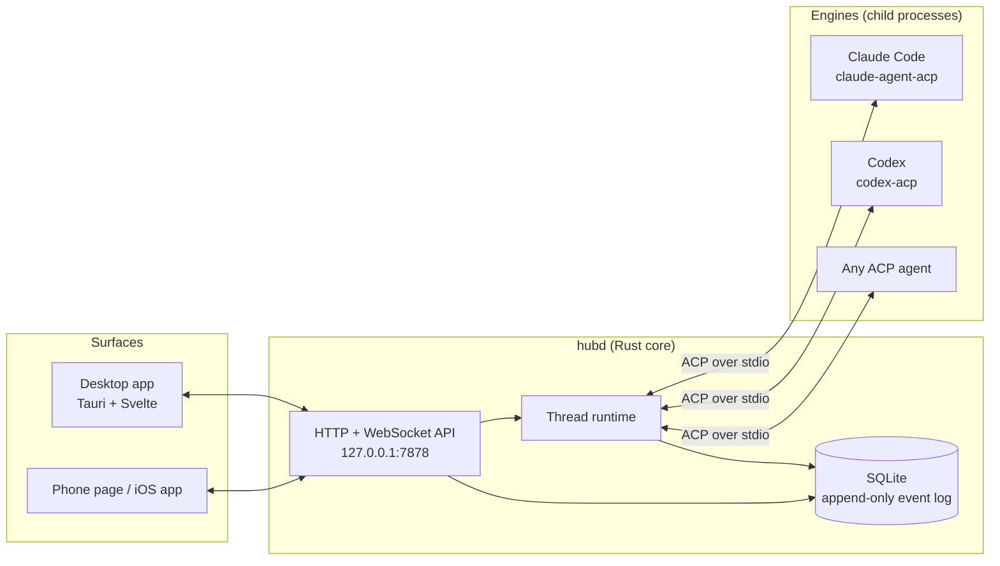
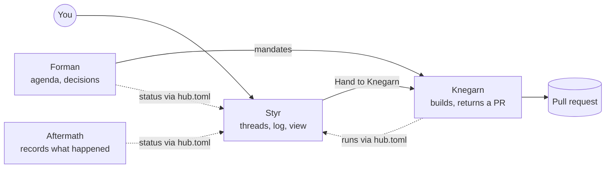

# Styr

A desktop app for keeping track of everything your AI coding agents are doing.

*Styr* is Old Norse for "to steer".

Working with AI agents gets messy fast. Threads multiply, agents drift off task, and work gets
left half done and forgotten in some terminal. I built this to have one place where I can see
all of it and steer it. It runs Claude Code (and Codex, or any agent that speaks the Agent Client
Protocol) in the background, writes everything that happens to a local log, and shows what is
running, what is waiting on me and what got finished. It is a personal project that I use every
day, built largely with AI agents working under the rules in [CLAUDE.md](CLAUDE.md).

---
*AI slop below this line.*

---

## What it does

- **Threads in any folder.** Each thread is a Claude Code or Codex session driven over ACP.
  Replies stream live. Tool calls and plans are shown. Permission questions wait for you with
  Allow and Reject.
- **Stop, queue, resume.** Stop a running turn or queue follow-ups while it works. The engine
  session is resumed after a crash, after closing the window and after restarting the core.
- **One event log.** Everything is appended to a SQLite log. Every view reads from it.
- **This computer.** CPU, memory and every listening port with its process, grouped by the
  thread whose folder it runs in. A Stop button for stray dev servers.
- **Projects.** Create a project from a name (folder, git, a plan in `docs/plan.md`, a GitHub
  repo if `gh` is logged in). The project page shows branch, PRs, CI, plan and threads.
- **Other machines.** Threads on other machines running the core show up in the same list,
  reached over Tailscale or an SSH tunnel. A phone page works over the tailnet.
- **Take over.** Open a thread's session in the engine's own CLI, in a terminal inside the app.
- **Workers.** Your own tools (see [the stack](#how-it-fits-with-the-rest-of-the-stack)) show
  their status, queues and buttons in the app.
- **Self-update.** The installed app builds new commits on `main` in the background and switches
  once no thread is working.

## Architecture



- The core is its own process (`hubd`), so threads keep running when the window closes.
- Engines are ACP agents started by command, one child process per active thread.
- The event log is append-only. New behaviour adds new event kinds instead of changing old ones.
- The Rust model is the source of truth for API types. TypeScript bindings are generated from it
  (`ts-rs`), so the app and core cannot drift apart.

| Path | What it is |
|---|---|
| `crates/hub-core` | The core library: model, store, thread runtime, ACP engine, API. |
| `crates/hubd` | The daemon binary and its subcommands (`pair`, `attach`, ...). |
| `crates/hub-install` | Where an installed version lives on disk. |
| `crates/hub-launcher` | Starts the current installed version. The Start menu points here. |
| `crates/mock-agent` | A scripted ACP agent for tests and for trying the UI without tokens. |
| `app/` | The Svelte UI. `app/src-tauri` is the desktop shell. |
| `ios/` | A SwiftUI client. |

More in [docs/ARCHITECTURE.md](docs/ARCHITECTURE.md) and [docs/MAP.md](docs/MAP.md).

## Install and build

Windows. Needs Git, Rust (stable), Node 22+, and Claude Code installed and logged in.

```powershell
git clone https://github.com/KarlssonChristoffer/hub.git
cd hub
powershell -ExecutionPolicy Bypass -File scripts\install.ps1
```

Development build:

```powershell
cd app; npm install; cd ..
cargo build -p hubd
cd app; npm run tauri dev
```

Tests:

```sh
cargo test --workspace                 # includes end-to-end thread tests against mock-agent
cd app && npm run check && npm test    # svelte-check and vitest
```

Updates, a second PC, config and the mock agent: [docs/INSTALL.md](docs/INSTALL.md).

## How it fits with the rest of the stack

This is the control surface. The other parts are separate repos:

- [Knegarn](https://github.com/KarlssonChristoffer/Knegarn) takes an approved task, builds it
  unattended and hands back a pull request.
- [Forman](https://github.com/KarlssonChristoffer/Forman) is the foreman over Knegarn: agenda,
  questions and decisions.
- [Aftermath](https://github.com/KarlssonChristoffer/Aftermath) records what actually happened
  and compares how the work was done.



Each tool puts a `hub.toml` in its own folder. The app reads it and shows that tool's status,
lists and actions, running the tool's own CLI. Examples: [docs/examples/](docs/examples/).

## Status

- Personal project, in daily use by one person. Not a product.
- Windows first. The core also runs on Linux (other machines). The iOS client is early.
- Written largely by AI agents (Claude Code, Codex) under the rules in `CLAUDE.md`, which are
  enforced by tests (`crates/hub-core/tests/it/rules.rs`).
- A few names are Swedish (Knegarn, Forman, some scripts and doc headers).

Third-party code and assets: [THIRD_PARTY_NOTICES.md](THIRD_PARTY_NOTICES.md).
